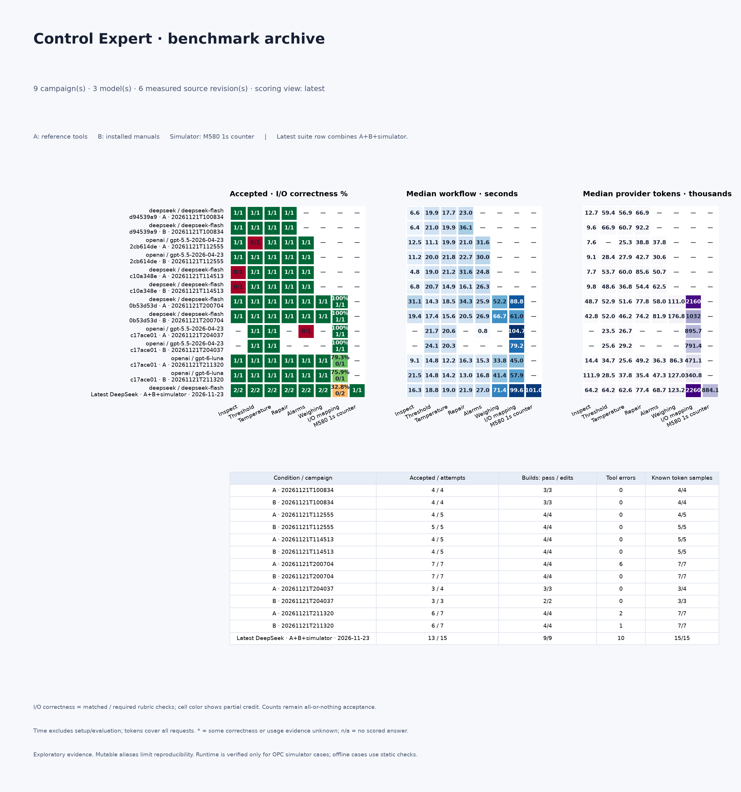

# Control Expert MCP Server

[](https://github.com/PBrunot/control-expert-mcp/actions/workflows/ci.yml)


[English](README.md) · Italiano

Collega un client MCP a un'installazione locale di **EcoStruxure Control Expert** (Unity Pro). Esplora, crea, modifica e compila progetti PLC tramite l'API di automazione COM UDE di Schneider Electric.

La base del progetto è l'interfaccia **Unity Developer Edition (UDE)** di Control Expert: questo server rende disponibili ai client MCP le operazioni di progettazione del progetto. La [documentazione pubblica Schneider Electric di Control Expert V16](https://www.se.com/us/en/download/document/EcoStruxureControlExpert_EN/) identifica UDE come API per automatizzare le attività di progettazione; il riferimento API dettagliato è installato localmente nella cartella `Extra` di Control Expert.

È un progetto sperimentale per la programmazione e il debug di PLC con l'assistenza di modelli linguistici.

[PyPI](https://pypi.org/project/control-expert-mcp/) · [Guida dettagliata (inglese)](docs/guide.md) · [Benchmark (inglese)](benchmarks/README.md)

> [!WARNING]
> Gli strumenti online possono trasferire applicazioni al PLC, avviare o arrestare i controllori e scrivere valori di processo. Sono disabilitati per impostazione predefinita. Usare un simulatore o un banco prova supervisionato; gli impianti di produzione richiedono personale qualificato.

## Funzionalità

- **Progetti:** creazione, apertura, salvataggio, importazione ed esportazione di progetti Control Expert.
- **Logica:** lettura e modifica di ST, LD, FBD, SFC e IL; gestione di variabili, DFB e DDT.
- **Hardware e comunicazioni:** configurazione di CPU, rack, moduli, DTM, servizi Ethernet e richieste di scansione Modbus.
- **Validazione:** verifica dell'XML di scambio, analisi e compilazione dei progetti, consultazione della diagnostica.
- **Documentazione:** ricerca nei manuali del produttore convertiti localmente, con citazioni delle fonti.
- **Accesso live (facoltativo):** OFS OPC DA per i valori simbolici o Modbus TCP per quelli con indirizzo assegnato; messa in servizio e test con PLC Simulator.

Le funzionalità disponibili dipendono dalla versione di Control Expert, dalla licenza, dal catalogo hardware e dalle librerie DTM installate. I client mostrano gli schemi degli argomenti e le descrizioni degli strumenti; vedere il [riferimento degli strumenti](docs/guide.md#tool-reference) e i [flussi guidati](docs/guide.md#guided-workflows), in inglese.

## Requisiti

- Windows con Python **3.11+**.
- Un'installazione locale con licenza di **Control Expert o Unity Pro**, con il broker COM UDE registrato (`PSBroker.PServerBroker.1`). Testato con Control Expert 14.0 e 16.4.
- Un client MCP con supporto **stdio**, come Claude Desktop, Claude Code, VS Code con GitHub Copilot, Codex o DeepSeek Harness.

Eseguire il server sulla stessa macchina di Control Expert. Il server di automazione UDE è incluso in Control Expert; il pacchetto UDE separato serve solo per la relativa documentazione.

## Avvio rapido

Installare sulla macchina Windows che esegue Control Expert:

```powershell
py -3.11 -m pip install --upgrade control-expert-mcp
```

Configurare il client MCP per avviare `control-expert-mcp` senza argomenti. Per i client che usano JSON con `mcpServers`, come Claude Desktop:

```json
{
  "mcpServers": {
    "control-expert": {
      "command": "control-expert-mcp",
      "args": [],
      "env": {
        "CE_MCP_ENABLE_ONLINE": "0"
      }
    }
  }
}
```

Per Codex CLI:

```powershell
codex mcp add control-expert --env CE_MCP_ENABLE_ONLINE=0 -- control-expert-mcp
```

Il client avvia e gestisce il server. Se non trova il comando, usare il percorso assoluto dell'eseguibile oppure l'interprete Python usato per l'installazione, con gli argomenti `["-m", "control_expert_mcp"]`.

La [guida alla configurazione dei client](docs/guide.md#mcp-client-configuration), in inglese, include Claude Desktop, Claude Code, VS Code, Codex e DeepSeek Harness. Gli esempi da adattare sono in [samples/](samples/).

## Utilizzo

Iniziare con un progetto di prova o una copia. Esempi di richieste:

- «Apri questo progetto e riepiloga CPU, task, sezioni e variabili globali.»
- «Crea una sezione ST per un interblocco motore, dichiara le variabili e compila il progetto.»
- «Esamina la configurazione hardware ed elenca i dispositivi Modbus configurati.»
- «Cerca `READ_VAR` nei manuali locali e cita l'argomento pertinente.»

Dopo le modifiche, compilare, controllare il risultato e salvare esplicitamente. Le importazioni possono sostituire sezioni esistenti; `close_project` scarta le modifiche se non si specifica `save=true`. L'apertura di un archivio `.sta` crea un'applicazione non salvata: salvarla indicando un percorso `.stu` esplicito.

Una compilazione riuscita non dimostra il corretto comportamento durante l'esecuzione. Controllare `build_state`, errori e output completo insieme alla diagnostica strutturata. Nei test runtime, confrontare le uscite con i risultati attesi e ripristinare gli ingressi di prova. Vedere [scrittura della logica e risultati di compilazione](docs/guide.md#usage), in inglese.

## Configurazione

Impostare queste variabili nell'ambiente del server definito dal client MCP:

| Variabile | Scopo |
| --- | --- |
| `CE_MCP_ENABLE_ONLINE` | Impostare a `1` e riavviare per esporre gli strumenti online. Disabilitata per impostazione predefinita; serve comunque il consenso per la sessione. |
| `CE_MCP_OPC_PYTHON` | Interprete Python con la stessa architettura della DLL OPC Automation e `pywin32` installato. OFS richiede spesso un interprete separato a 32 bit. |
| `CE_MCP_SCHEMA_DIR` | Percorso della directory `SrcXmlSchema` di Control Expert, in alternativa al rilevamento automatico. |
| `CE_MCP_MANUALS_DIR` | Manuali locali convertiti e indicizzati. Per le installazioni da pacchetto, impostare un percorso assoluto. |
| `CE_MCP_SIMULATOR_EXE` | Percorso facoltativo dell'eseguibile del simulatore per installazioni personalizzate o avvio senza un progetto aperto. |

### Accesso al PLC e al simulatore

Abilitare gli strumenti online **non** autorizza l'accesso a un controllore. Usare `get_live_access_setup` e `configure_live_access` per registrare le scelte dell'utente a ogni sessione del server. Per OPC, confermare la disponibilità di OFS e l'alias del dispositivo; ottenere un'approvazione separata per scritture in anello chiuso e comandi al PLC.

Preferire **OFS OPC DA** per i test sul simulatore e l'accesso alle variabili simboliche, comprese quelle senza indirizzo assegnato e i membri DFB esposti. Il dizionario dati dell'applicazione in esecuzione deve esporre i simboli richiesti. **Modbus TCP** supporta i valori con indirizzo `%M` / `%MW`.

Seguire la [guida all'accesso live e alla messa in servizio](docs/guide.md#plc-and-simulator-access), in inglese, per configurazione, dizionario dati, trasferimento e procedura alternativa in caso di errore “Family check failed”.

### Manuali locali

La ricerca nei manuali funziona senza una sessione COM o una connessione al PLC. Prima occorre convertire la guida installata localmente e crearne l'indice; i contenuti del produttore generati restano locali. Vedere [conversione e ricerca nei manuali](docs/guide.md#searchable-local-manuals), in inglese.

## Risoluzione dei problemi

- **Avvio COM non riuscito:** verificare licenza e registrazione UDE. Se il broker segnala un errore di integrità, riavviarlo dopo aver controllato i percorsi delle variabili d'ambiente Windows `CommonProgramFiles`.
- **CPU o modulo non trovato:** usare riferimento e versione esatti del catalogo installato.
- **Timeout alla prima chiamata:** il caricamento del progetto può richiedere 30–120 secondi; aumentare il timeout degli strumenti nel client.
- **Importazione XML non riuscita:** esportare un oggetto simile ed eseguire `validate_xml` prima dell'importazione.

Altri casi sono nella [guida alla risoluzione dei problemi](docs/guide.md#troubleshooting), in inglese. Segnalare problemi riproducibili su [GitHub Issues](https://github.com/PBrunot/control-expert-mcp/issues), includendo versioni, chiamate agli strumenti ed errori privi di dati sensibili.

## Benchmark

La suite offline valuta sette attività: ispezione del progetto, modifiche alla
logica di soglia e temperatura, riparazione di errori, allarmi con isteresi,
analisi della pesatura e mappatura I/O. Ogni attività viene eseguita su una copia
temporanea del progetto in due condizioni: senza e con la ricerca nei manuali
installati. Le modifiche vengono riaperte e compilate in modo indipendente; le
risposte di ispezione sono valutate con criteri deterministici, incluso un formato
Markdown fisso per la mappatura I/O. Un test separato sul simulatore M580 verifica
tramite OFS OPC DA che `TEST_LLM` venga incrementato una volta al secondo.



I risultati sono esplorativi: l'accettazione nei test offline non dimostra il
corretto funzionamento del PLC durante l'esecuzione. Consultare la [guida ai
benchmark](benchmarks/README.md) per definizioni, punteggi, configurazione e limiti,
e i [risultati archiviati](benchmarks/archive/README.md) per i rapporti delle
singole esecuzioni. La documentazione è in inglese.

## Sviluppo

```powershell
git clone https://github.com/PBrunot/control-expert-mcp.git
cd control-expert-mcp
py -3.11 -m venv .venv
.venv\Scripts\python.exe -m pip install -e ".[benchmark,test]"
.venv\Scripts\python.exe -m compileall -q src
.venv\Scripts\python.exe -m unittest discover -s tools -p "test_*.py"
```

Per un'installazione da sorgente, configurare il client MCP con il percorso assoluto di `.venv\Scripts\python.exe` e gli argomenti `["-m", "control_expert_mcp"]`.

Consultare [AGENTS.md](AGENTS.md) per le convenzioni del repository, la [guida allo sviluppo](docs/guide.md#development-and-validation) per architettura e verifiche di integrazione, e [creazione dei pacchetti e rilasci](docs/guide.md#packaging-and-releases) per i comandi di distribuzione. Questi riferimenti sono in inglese. Esaminare gli script di integrazione prima di eseguirli: possono modificare progetti o terminare Control Expert.

## Licenza e riconoscimenti

Questo repository è un fork di [apexsotjo-blip/control-expert-mcp](https://github.com/apexsotjo-blip/control-expert-mcp), con contributi aggiuntivi di Pascal Brunot. Il repository originale non includeva un file di licenza; la licenza MIT di questo fork si applica ai contributi di Pascal Brunot e non modifica la licenza dei contributi upstream o dei materiali di terze parti. Consultare [LICENSE](LICENSE) e la cronologia del repository upstream per la provenienza. Il progetto è inoltre ispirato a [tiaportal-mcp](https://github.com/heilingbrunner/tiaportal-mcp).

Il progetto non è affiliato né approvato da Schneider Electric. Software, licenze e documentazione di Control Expert e Unity Pro sono forniti separatamente.
