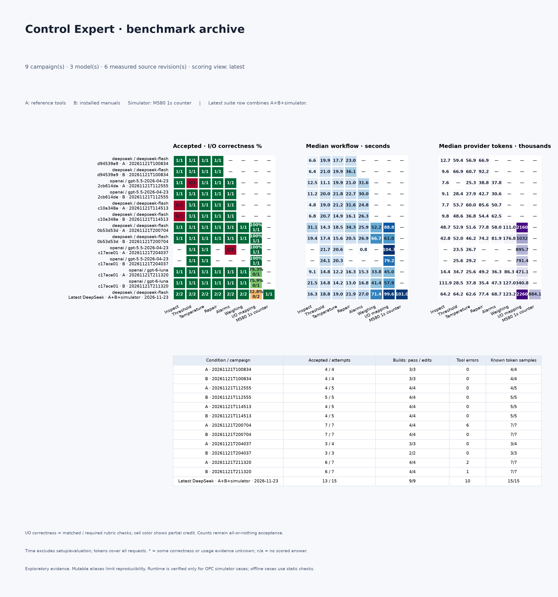

# Control Expert MCP Server

[](https://github.com/PBrunot/control-expert-mcp/actions/workflows/ci.yml)


English · [Italiano](README.it.md)

An MCP server for a local **EcoStruxure Control Expert** (Unity Pro) installation. It lets an MCP client inspect, create, edit, and build PLC projects through Control Expert's **Unity Developer Edition (UDE)** COM API. Experimental, for LLM-assisted PLC programming.

[PyPI](https://pypi.org/project/control-expert-mcp/) · [Detailed guide](docs/guide.md) · [Benchmarks](benchmarks/README.md)

> [!WARNING]
> Online tools can download applications, start or stop controllers, and write process values. They are disabled by default. Use a simulator or a supervised test bench; production equipment requires qualified supervision. A build while a target is connected is an online change and is refused unless `build_project` is called with `allow_online_change=true` after closed-loop approval.

## Features

- **Projects:** create, open, save, import, and export.
- **Logic:** read and edit ST, LD, FBD, SFC, and IL; manage variables, DFBs, and DDTs.
- **Hardware:** configure CPUs, racks, modules, DTMs, Ethernet services, and Modbus scan requests.
- **Validation:** validate exchange XML, analyze and build, read diagnostics.
- **Manuals:** search locally converted vendor manuals with citations.
- **Live access (opt-in):** OFS OPC DA for symbolic values, Modbus TCP for located `%M`/`%MW` values, PLC Simulator commissioning.

Availability depends on your installation, license, and catalogs. See the [tool reference](docs/guide.md#tool-reference) and [guided workflows](docs/guide.md#guided-workflows).

## Requirements

- Windows, Python **3.11+**.
- Licensed local **Control Expert or Unity Pro** with its UDE COM broker (`PSBroker.PServerBroker.1`) registered. Tested with Control Expert 14.0 and 16.4.
- An MCP client with **stdio** support (Claude Desktop, Claude Code, VS Code with GitHub Copilot, Codex, DeepSeek Harness).

Run the server on the Control Expert machine.

## Install and configure

```powershell
py -3.11 -m pip install --upgrade control-expert-mcp
```

Configure the client to launch `control-expert-mcp` (for example in Claude Desktop):

```json
{
  "mcpServers": {
    "control-expert": {
      "command": "control-expert-mcp",
      "args": [],
      "env": { "CE_MCP_ENABLE_ONLINE": "0" }
    }
  }
}
```

### Claude Code and Codex: server + workflow skill

The [`control-expert` skill](plugin/skills/control-expert/SKILL.md) is a short workflow checklist: inspect before editing, the build loop, symbol candidates, verifying Modicon constructs in the manuals, and live-access consent. It uses the standard `SKILL.md` format and works in both agents.

**Claude Code:** one plugin installs the server (via `uvx`, needs [uv](https://docs.astral.sh/uv/)) and the skill:

```text
/plugin install control-expert --marketplace PBrunot/control-expert-mcp
```

Online tools stay off unless you enable the plugin option "Expose online tools". Skill only, with your own server config: copy `plugin/skills/control-expert` to `~/.claude/skills/control-expert`.

**Codex:** add the server, then the skill:

```text
codex mcp add control-expert --env CE_MCP_ENABLE_ONLINE=0 -- control-expert-mcp
```

In Codex, ask: `$skill-installer install https://github.com/PBrunot/control-expert-mcp/tree/main/plugin/skills/control-expert`. Or copy `plugin/skills/control-expert` to `~/.agents/skills/control-expert` (all projects) or `.agents/skills/control-expert` (one repository). Restart Codex if the skill does not appear.

ChatGPT web/desktop connects only to remote HTTPS MCP servers, so it cannot launch this local Windows server; use Codex.

If the command is not found, use its absolute path, or the installing Python with arguments `["-m", "control_expert_mcp"]`. Other clients: [client configuration](docs/guide.md#mcp-client-configuration) and [samples/](samples/).

Environment variables:

| Variable | Purpose |
| --- | --- |
| `CE_MCP_ENABLE_ONLINE` | `1` exposes online tools (restart required). Session consent is still required. |
| `CE_MCP_OPC_PYTHON` | Python matching the OPC Automation DLL bitness, with `pywin32` (often 32-bit for OFS). |
| `CE_MCP_SCHEMA_DIR` | Override the auto-discovered `SrcXmlSchema` directory. |
| `CE_MCP_MANUALS_DIR` | Absolute path to converted, indexed manuals. |
| `CE_MCP_SIMULATOR_EXE` | Optional simulator executable path. |

## Usage

Work on a disposable project or a copy. Example requests:

- "Open this project and summarize its CPU, tasks, sections, and global variables."
- "Create an ST section for a motor interlock, declare its variables, and build the project."
- "Search the local manuals for `READ_VAR` and cite the relevant topic."

Build after changes and save explicitly: `close_project` discards changes unless `save=true`, and an opened `.sta` archive must be saved to a `.stu` path. A successful build does not prove runtime correctness. See [usage](docs/guide.md#usage).

**Live access:** enabling online tools does not grant access to a controller. Call `get_live_access_setup` and `configure_live_access` each session; closed-loop writes and PLC control need separate approval. Prefer OFS OPC DA. See [PLC and simulator access](docs/guide.md#plc-and-simulator-access).

**Manuals:** convert and index your installed help first; see [searchable local manuals](docs/guide.md#searchable-local-manuals).

Problems: [troubleshooting](docs/guide.md#troubleshooting) and [GitHub Issues](https://github.com/PBrunot/control-expert-mcp/issues).

## Benchmarks

`ce-bench` runs an offline seven-task suite (with and without manual search), an IEC language suite, and an M580 simulator test. Results are exploratory and do not prove PLC runtime correctness. See the [benchmark guide](benchmarks/README.md) and [archived results](benchmarks/archive/README.md).



## Development

```powershell
git clone https://github.com/PBrunot/control-expert-mcp.git
cd control-expert-mcp
py -3.11 -m venv .venv
.venv\Scripts\python.exe -m pip install -e ".[benchmark,test]"
.venv\Scripts\python.exe -m unittest discover -s tools -p "test_*.py"
```

See [AGENTS.md](AGENTS.md), [development and validation](docs/guide.md#development-and-validation), and [packaging and releases](docs/guide.md#packaging-and-releases).

## License and credits

This repository is a fork of [apexsotjo-blip/control-expert-mcp](https://github.com/apexsotjo-blip/control-expert-mcp), with additional work by Pascal Brunot. The upstream repository did not include a license file, so the MIT license in this fork applies to Pascal Brunot's contributions and does not relicense upstream contributions or third-party materials. See [LICENSE](LICENSE) and the upstream repository history for provenance. Inspired by [tiaportal-mcp](https://github.com/heilingbrunner/tiaportal-mcp).

Not affiliated with or endorsed by Schneider Electric. Control Expert and Unity Pro software, licenses, and documentation are supplied separately.
