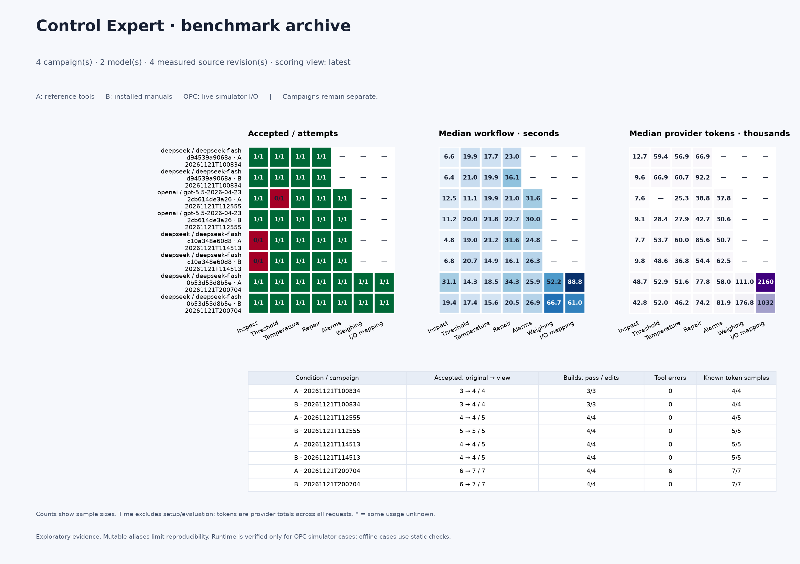

# Archived benchmark runs

Sanitized results intended for Git history. Raw evidence stays local.

Regenerate from this archive with `ce-bench visualize --archive benchmarks/archive --output benchmarks/archive/overview.png`.

| Run | Provider | Model | Measured source | Original accepted | Regraded accepted | Complete |
|---|---|---|---|---|---|---|
| [20261121T100834Z-be7edc84](20261121T100834Z-be7edc84/report.md) | deepseek | deepseek-flash | d94539a9068a | 6/8 | feeder-2: 8/8 | True |
| [20261121T112555Z-608e42da](20261121T112555Z-608e42da/report.md) | openai | gpt-5.5-2026-04-23 | 2cb614de3a26 | 9/10 | none | True |
| [20261121T114513Z-a78f24bc](20261121T114513Z-a78f24bc/report.md) | deepseek | deepseek-flash | c10a348e60d8 | 8/10 | none | True |
| [20261121T200704Z-5bbd9b33](20261121T200704Z-5bbd9b33/report.md) | deepseek | deepseek-flash | 0b53d53d8b5e | 12/14 | demo-io-mapping-2: 14/14 | True |
